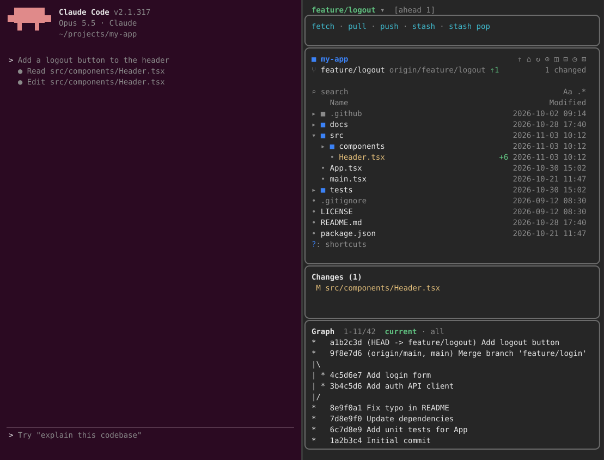

# git-claude-mods

[English](README.md) | 한국어

대화 옆에서 git 작업을 하기 위한 Claude Code mod 모음입니다.

## git-pane

git 에 필요한 것을 대화 옆 pane 하나에 위에서부터 차례로 보여 줍니다.



- **브랜치 선택**: 브랜치명을 누르면 로컬 브랜치와 원격 브랜치가 나뉘어 보입니다.
  main, master, develop, release 가 먼저 나오고, 그다음 현재 브랜치, 나머지는 마지막 커밋 날짜 순입니다.
  브랜치를 더블 클릭하거나, 선택한 뒤 `checkout` 을 누르면 체크아웃합니다.
  브랜치를 우클릭하면 현재 브랜치에 merge 하거나 그 브랜치 위로 rebase 할 수 있습니다.
  tracked 파일에 변경이 있으면 checkout, merge, rebase 를 하지 않습니다.
- **동작 버튼**: `fetch`, `pull`(`--ff-only`), `push`(upstream 이 없으면 `origin` 에 설정), `stash`, `stash pop`.
  git 작업은 한 번에 하나씩 실행되고, 결과는 toast 로 알려 줍니다. force push 는 없습니다.
- **파일 트리**: Claude 가 작업하는 폴더를 git 상태, 미리보기, treemap, 검색과 함께 보여 주고,
  Claude 가 읽고 쓰는 파일을 강조합니다. git 저장소 밖에서는 트리만 보여 줍니다.
- **Changes**: 변경된 파일을 누르면 그 파일의 diff 를 보여 줍니다.
- **Graph**: 현재 브랜치의 이력을 보여 주고, `all` 을 누르면 모든 브랜치의 이력을 보여 줍니다.
  커밋을 누르면 메시지, 변경된 파일 목록, 패치를 보여 주고, 거기서 파일을 누르면 그 커밋에서 그 파일이 바뀐 내용을 보여 줍니다.
- 각 영역은 높이가 고정되어 있고, 마우스 휠로 따로 스크롤됩니다.

### 요구 사항

- mod(hooks 모듈이 있는 플러그인)를 지원하는 Claude Code. 2.1.316 에서 시험했습니다.
- 터미널에서는 fullscreen 레이아웃(`/tui fullscreen`)과 폭 110칸 이상일 때 대화 옆에 pane 이 붙습니다.
- `PATH` 에 `git` 2.31 이상.

### 설치

Claude Code 터미널 세션의 프롬프트에서:

```
/plugin install git-pane --marketplace <owner>/git-claude-mods
```

설치 도중 marketplace 를 추가할지 확인하는 화면이 나오면 `y` 를 입력하고, 이어서 설치 범위를 선택하세요. 셸에서 설치하려면 다음 명령을 실행합니다.

```
claude plugin install git-pane --marketplace <owner>/git-claude-mods
```

세션이 시작되면 pane 이 열립니다. `/git` 으로 열고 `/git-close` 로 닫습니다.

### 설정

`/config` 에 git-pane 설정이 있습니다. 파일 트리의 아이콘(glyphs), 보여 줄 Claude 활동, 미리보기, treemap,
"Open at start"(off 로 하면 `/git` 을 실행할 때까지 pane 을 열지 않음) 등을 바꿀 수 있습니다.

### 개발

```
claude --plugin-dir ./git-pane        # mod 를 불러온 세션 시작
claude plugin validate ./git-pane     # 매니페스트와 hooks 모듈 검사
claude plugin test ./git-pane         # 시험 실행
```

## 출처

파일 트리는 Kurt Buhler 의 [filetree](https://github.com/data-goblin/claude-code-filetree) 0.6.0(MIT)을
pane 에 통합한 것입니다. 라이선스는 `git-pane/LICENSE-filetree` 에 있습니다.

## 라이선스

MIT, `LICENSE` 를 참고하세요.
