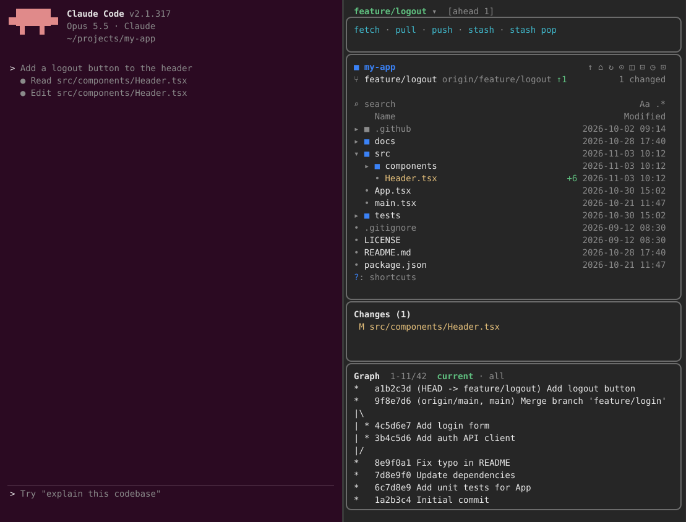

# git-claude-mods

English | [한국어](README.ko.md)

Claude Code mods for working with git beside the conversation.

## git-pane

One pane next to the chat with everything git, top to bottom:



- **Branch picker**: click the branch name for local and remote branches apart
  (main, master, develop and release first, then the current branch, then the rest
  by last commit date). Double-click a branch to check it out, or select it and
  press `checkout`. Right-click a branch to merge it into the current one or rebase
  onto it. A checkout, merge or rebase is refused while tracked files have changes.
- **Actions**: `fetch`, `pull` (`--ff-only`), `push` (sets an upstream on `origin`
  when there is none), `stash`, `stash pop`. One git job runs at a time; results
  show as toasts. No force push.
- **File tree**: the folder Claude works in, with git status, previews, a treemap,
  search and Claude's reads and writes highlighted. Outside a git repository the
  pane shows the tree alone.
- **Changes**: click a changed file for its diff.
- **Graph**: the current branch's history, or every branch with `all`. Click a
  commit for its message, the files it changed and its patch; click a file there
  for that file's change in the commit.
- Each part keeps a fixed height and scrolls on its own with the wheel.

### Requirements

- Claude Code with mods (plugins with hooks modules); tested on 2.1.316.
- In the terminal the pane docks beside the transcript in the fullscreen layout
  (`/tui fullscreen`) on a terminal at least 110 columns wide.
- `git` 2.31 or newer on `PATH`.

### Install

At the prompt of a Claude Code terminal session:

```
/plugin install git-pane --marketplace <owner>/git-claude-mods
```

Answer `y` to add the marketplace, then pick a scope. From a shell:

```
claude plugin install git-pane --marketplace <owner>/git-claude-mods
```

The pane opens when a session starts. `/git` opens it, `/git-close` closes it.

### Settings

`/config` lists git-pane's settings: the file tree's glyphs, what Claude activity
it shows, the preview, the treemap, "Open at start" (off: the pane waits for
`/git`) and more.

### Development

```
claude --plugin-dir ./git-pane        # run a session with the mod loaded
claude plugin validate ./git-pane     # check the manifest and the hooks module
claude plugin test ./git-pane         # run the tests
```

## Credits

The file tree is [filetree](https://github.com/data-goblin/claude-code-filetree)
0.6.0 by Kurt Buhler (MIT), built into the pane. Its license is in
`git-pane/LICENSE-filetree`.

## License

MIT, see `LICENSE`.
